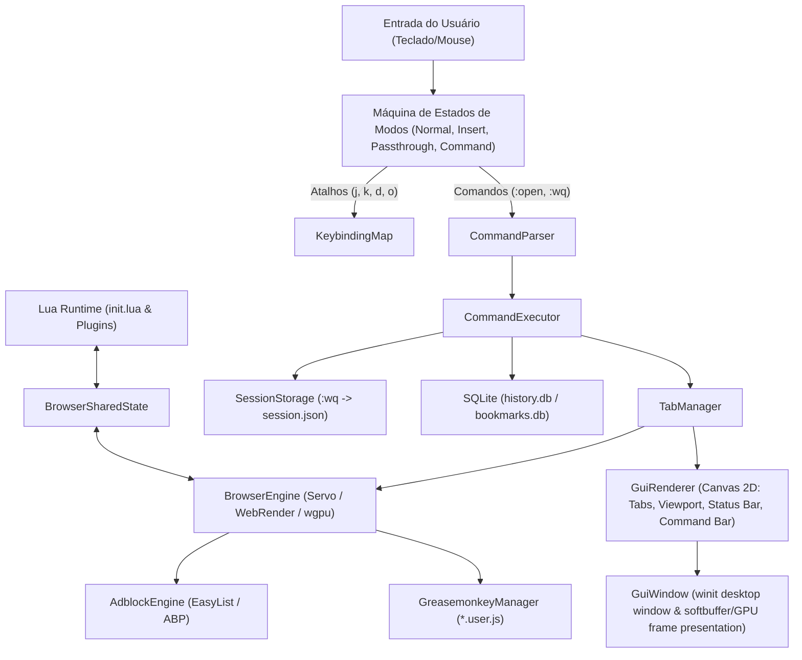

# Arquitetura e Princípios de Clean Code — NServo

O **NServo** foi concebido desde a sua primeira linha de código para ser um navegador web de alta fidelidade, modular, legível e mantido com tranquilidade por seres humanos, sem a necessidade de ferramentas de inteligência artificial para desvendar estruturas monolíticas ou código espaguete.

---

## 1. Princípios de Clean Code e SOLID

### 1.1 Single Responsibility Principle (SRP)
Cada arquivo e módulo executa apenas uma responsabilidade específica:
- `src/command/parser.rs`: Exclusivamente interpreta a string do comando e produz uma variante tipada de `CommandAction`.
- `src/command/executor.rs`: Apenas executa a ação tipada contra os estados do navegador.
- `src/adblock/parser.rs`: Interpreta sintaxe de listas de bloqueio.
- `src/adblock/engine.rs`: Aplica as regras de bloqueio a URLs e domínios.

### 1.2 Open/Closed Principle (OCP)
Novos motores de renderização podem ser adicionados implementando a trait `BrowserEngine`:
```rust
pub trait BrowserEngine: Send + Sync {
    fn load_url(&mut self, url: &str) -> Result<()>;
    fn reload(&mut self) -> Result<()>;
    fn eval_js(&mut self, script: &str) -> Result<String>;
    fn scroll_by(&mut self, dx: i32, dy: i32);
    fn render(&mut self) -> Result<()>;
    // ...
}
```
Isso permite acoplar o Servo nativo, um backend WebRender direto, testes em memória com `MockEngine` ou um backend headless sem modificar o código de abas, comandos ou UI.

### 1.3 Liskov Substitution Principle (LSP)
Tanto `ServoEngine` quanto `MockEngine` implementam a trait `BrowserEngine` de modo 100% intercambiável dentro de `Tab`.

### 1.4 Interface Segregation Principle (ISP)
Em vez de uma struct de interface monstruosa com centenas de métodos, os contratos são divididos em traits coesas e específicas.

### 1.5 Dependency Inversion Principle (DIP)
Módulos de alto nível (como `TabManager` e `App`) dependem de abstrações (`BrowserEngine`, `SessionStorage`), não de detalhes de implementação rígidos.

---

## 2. A Regra dos 200 Linhas

Nenhum arquivo fonte `.rs` dentro do projeto ultrapassa **200 linhas de código**. Se qualquer subsistema se expande, ele é imediatamente modularizado:

```text
src/
├── app/               # Separado em mod.rs, state.rs e event_handler.rs
├── browser/           # Separado em traits.rs, event.rs, servo.rs e mock.rs
├── command/           # Separado em action.rs, parser.rs, autocomplete.rs e executor.rs
├── config/            # Separado em options.rs, keybindings.rs e init_files.rs
├── lua/               # Separado em engine.rs, state.rs, globals.rs e bindings_*
├── adblock/           # Separado em rule.rs, parser.rs, engine.rs e defaults.rs
└── greasemonkey/      # Separado em metadata.rs, script.rs, manager.rs e defaults.rs
```

Essa disciplina garante clareza cognitiva imediata para qualquer desenvolvedor inspecionando o código.

---

## 3. Diagrama Geral de Comunicação e Fluxo de Dados


