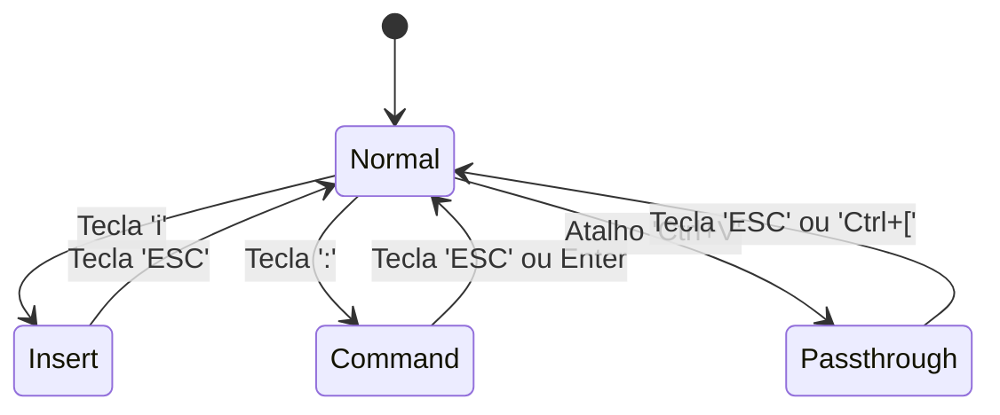

# NServo — Modern Keyboard-Centric Web Browser

> **NServo** é um navegador web moderno, minimalista e extensível, escrito em **Rust** e concebido sobre a arquitetura do motor **Servo**. Inspirado diretamente pela experiência de uso do **Neovim**, **Vim**, **qutebrowser** e **Nyxt**, o NServo oferece navegação veloz quase inteiramente pelo teclado, com aceleração por GPU, configuração completa em **Lua**, sistema de plugins com verificação de segurança, suporte a scripts **Greasemonkey**, bloqueador de anúncios integrado compatível com listas **ABP/EasyList** e persistência de sessões.

Todo o projeto foi meticulosamente desenhado para ser compreendido e mantido por seres humanos sem depender de inteligências artificiais. Rigorosamente nenhum arquivo fonte ultrapassa **200 linhas de código**, respeitando princípios fundamentais de Clean Code, SOLID e modularidade.

---

## Sumário

- [Introdução](#introdução)
- [Objetivos do Projeto](#objetivos-do-projeto)
- [Filosofia de Uso e Modos de Operação](#filosofia-de-uso-e-modos-de-operação)
- [Keybindings Padrão](#keybindings-padrão)
- [Linha de Comando e Comandos Disponíveis](#linha-de-comando-e-comandos-disponíveis)
- [Estrutura de Diretórios](#estrutura-de-diretórios)
- [Dependências do Sistema](#dependências-do-sistema)
- [Compilação e Instalação](#compilação-e-instalação)
- [Execução](#execução)
- [Sistema de Configuração (init.lua)](#sistema-de-configuração-initlua)
- [Sistema de Plugins](#sistema-de-plugins)
  - [Segurança e Confiança de Plugins](#segurança-e-confiança-de-plugins)
  - [Plugin Padrão: pass](#plugin-padrão-pass)
  - [Plugin Padrão: readability](#plugin-padrão-readability)
- [Sistema Greasemonkey (UserScripts)](#sistema-greasemonkey-userscripts)
- [Bloqueador de Anúncios (ABP / EasyList)](#bloqueador-de-anúncios-abp--easylist)
- [Persistência de Sessão e Restauração Automática](#persistência-de-sessão-e-restauração-automática)
- [Bancos de Dados SQLite (Histórico e Favoritos)](#bancos-de-dados-sqlite-histórico-e-favoritos)
- [Autocompletion Inteligente](#autocompletion-inteligente)
- [Empacotamento Multiplataforma](#empacotamento-multiplataforma)
  - [Linux](#linux)
  - [Windows](#windows)
  - [macOS](#macos)
  - [Android](#android)
- [Licença](#licença)

---

## Introdução

A web moderna tornou-se sobrecarregada por navegadores monolíticos, pesados e cheios de telemetria desnecessária, com interfaces gráficas saturadas de elementos visuais dispersivos.

O **NServo** resgata a pureza da navegação web: uma janela gráfica nativa (GUI) moderna e focada exclusivamente no conteúdo, com uma barra de status discreta que comunica o essencial e uma linha de comando poderosa na base, acessível sob demanda.

Ao aliar a robustez do **Rust** à velocidade do motor **Servo** e da arquitetura gráfica **WebRender / wgpu / softbuffer**, o NServo entrega uma janela desktop rápida, responsiva, com aceleração por hardware e segurança de memória.

---

## Objetivos do Projeto

1. **Eficiência Orientada ao Teclado**: Navegação completa sem tirar as mãos do teclado, com atalhos intuitivos inspirados no ecossistema Vim/Neovim.
2. **Arquitetura Humana e Clean Code**: Código fonte limpo, desacoplado e estritamente restrito a arquivos de **menos de 200 linhas**, garantindo manutenibilidade sem sobrecarga cognitiva.
3. **Extensibilidade Ilimitada em Lua**: Configuração central via `init.lua`, mapeamento de teclas e criação de plugins nativos com acesso às APIs do navegador.
4. **Privacidade e Segurança por Padrão**: Bloqueador de anúncios e telemetria nativo com suporte a listas ABP, sandboxing de scripts Greasemonkey e prompt interativo obrigatório para confiar em novos plugins.
5. **Portabilidade Multiplataforma Real**: Núcleo compartilhado entre Linux, Windows, macOS e Android, com suporte nativo a teclados físicos em dispositivos móveis.

---

## Filosofia de Uso e Modos de Operação

O NServo adota uma máquina de estados modal idêntica ao Neovim e ao qutebrowser:



### 1. Normal Mode
- **Modo padrão do navegador**.
- Todas as teclas de navegação rápida estão ativas (`j`, `k`, `h`, `l`, `d`, `o`, etc.).
- Permite rolar páginas, alternar abas, favoritar e abrir a linha de comando.

### 2. Insert Mode
- **Ativação**: Pressione `i` no modo normal.
- **Saída**: Pressione `ESC`.
- **Comportamento**: Os toques no teclado são transmitidos diretamente para os campos de texto e formulários da página web. O navegador não intercepta seus atalhos normais.

### 3. Passthrough Mode
- **Ativação**: Pressione `Ctrl+V` no modo normal.
- **Saída**: Pressione `ESC` ou `Ctrl+[`.
- **Comportamento**: Modo de passagem direta. Todo e qualquer evento de entrada do teclado ou mouse vai diretamente para a aplicação web sem qualquer filtro, ideal para jogos em HTML5, VNC web ou editores online (como Google Docs ou Monaco Editor).

### 4. Command Mode
- **Ativação**: Pressione `:` no modo normal.
- **Saída**: Pressione `ESC` para cancelar ou `Enter` para executar.
- **Comportamento**: Abre a barra de comando inferior para digitação de comandos `:open`, `:tabnew`, `:wq`, etc., com autocompletion flutuante instantâneo.

---

## Keybindings Padrão

Os atalhos padrão vêm pré-configurados e podem ser inteiramente redefinidos no arquivo `init.lua`:

| Tecla | Ação no Navegador | Modo |
| :--- | :--- | :--- |
| `j` | Rolar para baixo (50px / suave) | Normal |
| `k` | Rolar para cima (50px / suave) | Normal |
| `h` | Rolar para a esquerda | Normal |
| `l` | Rolar para a direita | Normal |
| `o` | Abrir prompt para carregar URL na aba atual | Normal |
| `O` | Abrir prompt para carregar URL em nova aba | Normal |
| `d` | Fechar a aba atual | Normal |
| `i` | Entrar no **Insert Mode** | Normal |
| `ESC` | Retornar imediatamente ao **Normal Mode** | Insert / Command / Passthrough |
| `:` | Abrir o **Command Mode** | Normal |
| `Ctrl+V` | Entrar no **Passthrough Mode** | Normal |
| `Ctrl+C` | Encerramento de emergência do processo | Qualquer |

---

## Linha de Comando e Comandos Disponíveis

Pressione `:` para acessar a barra de comando:

| Comando | Descrição | Exemplo |
| :--- | :--- | :--- |
| `:open <URL>` | Abre a URL especificada na aba atual | `:open https://servo.org` |
| `:Open <URL>` | Abre a URL especificada em uma **nova aba** | `:Open https://crates.io` |
| `:tabnew [URL]` | Cria uma nova aba (em branco ou com URL informada) | `:tabnew https://github.com` |
| `:tabnext` | Alterna para a próxima aba aberta | `:tabnext` |
| `:tabprev` | Alterna para a aba aberta anterior | `:tabprev` |
| `:tabclose` | Fecha a aba ativa | `:tabclose` |
| `:tabs` | Lista todas as abas abertas e seus títulos no status bar | `:tabs` |
| `:wq` | **Salva a sessão** (abas, URLs, posição de scroll) e sai | `:wq` |
| `:q` | Fecha o navegador imediatamente | `:q` |
| `:plugin <NOME>` | Executa um plugin Lua instalado | `:plugin pass` ou `:plugin readability` |
| `:bookmark` | Salva a página ativa nos favoritos (com tags opcionais) | `:bookmark` |
| `:clean` | Limpa o histórico e favoritos sob confirmação do usuário | `:clean` |

---

## Estrutura de Diretórios

O código fonte está organizado de forma estritamente modular:

```text
src/
├── adblock/        # Bloqueador de anúncios: parsing ABP, filtros cosméticos e motor de rede
│   ├── defaults.rs # Lista EasyList embutida inicial
│   ├── engine.rs   # Matching de URLs e seletores CSS
│   ├── parser.rs   # Analisador sintático de regras ABP
│   └── rule.rs     # Definições de AdRule, RuleType e ContentType
├── app/            # Estado central da aplicação e orquestração de eventos
│   ├── event_handler.rs # Despacho de teclas da interface gráfica
│   ├── gui_window.rs    # Janela desktop nativa via winit e softbuffer
│   └── state.rs    # Estrutura principal App e controle do frame buffer
├── bookmarks/      # Sistema de Favoritos com persistência em SQLite
│   ├── db.rs       # Queries SQLite parametrizadas
│   └── entry.rs    # Modelo BookmarkEntry
├── browser/        # Camada de abstração do motor de renderização
│   ├── event.rs    # EngineEvent, NavigationState e ScrollPosition
│   ├── mock.rs     # Motor in-memory para testes unitários e headless
│   ├── servo.rs    # Integração com Servo / WebRender / wgpu
│   └── traits.rs   # Trait BrowserEngine (contrato do motor)
├── command/        # Linha de comando e autocompletion
│   ├── action.rs   # Enum CommandAction tipado
│   ├── autocomplete.rs # Sugestões ponderadas por histórico e favoritos
│   ├── executor.rs # Execução das ações nos subsistemas
│   └── parser.rs   # Parser sintático de linhas de comando
├── config/         # Configurações do usuário e inicializador
│   ├── init_files.rs   # Criação automática dos arquivos padrão do usuário
│   ├── keybindings.rs  # Mapeamento dinâmico de teclas
│   └── options.rs      # ConfigOptions (smooth_scroll, homepage, etc.)
├── greasemonkey/   # Motor de UserScripts Greasemonkey
│   ├── defaults.rs # UserScript de exemplo inicial
│   ├── manager.rs  # Descoberta de *.user.js no diretório
│   ├── metadata.rs # Parser do bloco // ==UserScript==
│   └── script.rs   # Validação de padrões @match e injeção de JS
├── history/        # Histórico de navegação em SQLite
│   ├── db.rs       # Registro de visitas, timestamps e buscas
│   └── entry.rs    # Modelo HistoryEntry
├── lua/            # Integração com a linguagem Lua (mlua)
│   ├── bindings_nservo.rs   # nservo.notify, nservo.bind, nservo.command
│   ├── bindings_page.rs     # nservo.page.url, title, html, eval_js
│   ├── bindings_storage.rs  # nservo.bookmarks.*, nservo.history.*
│   ├── bindings_tabs.rs     # nservo.tabs.new, close, next, prev
│   ├── engine.rs            # Inicialização da VM Lua
│   ├── globals.rs           # Helpers globais: set(), bind(), command(), open()
│   └── state.rs             # BrowserSharedState thread-safe
├── modes/          # Máquina de estados dos modos
│   ├── mode.rs     # Enum Mode (Normal, Insert, Passthrough, Command)
│   └── state.rs    # Transições de estado
├── platform/       # Suporte a Linux, Windows, macOS e Android
│   ├── android.rs  # Mapeamento de keycodes e contexto Android JNI
│   ├── paths.rs    # Resolução de diretórios conforme padrão XDG
│   └── process.rs  # Execução segura de utilitários externos (como pass)
├── plugins/        # Gerenciamento de extensões locais em Lua
│   ├── manager.rs  # Descoberta e validação de confiança
│   ├── pass.rs     # Plugin padrão para preenchimento de senhas via Unix pass
│   ├── plugin.rs   # Modelo PluginInfo
│   └── readability.rs # Plugin padrão de modo de leitura estilo e-book
├── security/       # Camada de segurança e confiança
│   ├── prompter.rs # Formatação do diálogo de confirmação de plugins
│   └── trust_store.rs # Armazenamento de hashes em trusted_plugins.json
├── session/        # Persistência de abas e coordenadas de rolagem
│   ├── model.rs    # SessionData e TabSessionData
│   └── storage.rs  # Leitura e escrita atômica de session.json
├── tabs/           # Controle de abas
│   ├── manager.rs  # TabManager (navegação entre abas, criação e fechamento)
│   └── tab.rs      # Instância de aba contendo o motor de renderização
└── ui/             # Renderizador da interface gráfica desktop nativa (GUI)
    ├── canvas.rs      # Buffer de pixels 2D e operações de desenho gráfico
    ├── colors.rs      # Paleta de cores moderna estilo Neovim/qutebrowser
    ├── command_bar_view.rs # Renderização gráfica da barra de comandos e autocomplete
    ├── dialog_view.rs # Diálogos modais gráficos de confirmação
    ├── font.rs        # Renderizador de fonte gráfica bitmap embutida
    ├── renderer.rs    # Compositor gráfico (abas, viewport, status, comandos)
    ├── status_bar_view.rs  # Barra de status gráfica com modos, URL e posição
    ├── tabs_view.rs   # Barra de abas gráfica superior em cápsulas visuais
    └── viewport_view.rs # Viewport de visualização da página web com scrollbar
```

---

## Dependências do Sistema

### Linux (Ubuntu, Debian, Fedora, Arch)
- Ferramental Rust estável (1.78+)
- Compilador C/C++ (`gcc` ou `clang`)
- Bibliotecas de sistema para SQLite e fontes (instaladas automaticamente pelas dependências empacotadas do Rust):
```bash
# Ubuntu / Debian
sudo apt update && sudo apt install -y build-essential pkg-config libsqlite3-dev

# Arch Linux
sudo pacman -S --needed base-devel sqlite

# Fedora
sudo dnf groupinstall "Development Tools" && sudo dnf install sqlite-devel
```

### Windows
- Rust para arquitetura MSVC (`x86_64-pc-windows-msvc`)
- Visual Studio C++ Build Tools (instalado via instalador do Visual Studio)

### macOS
- Rust (`aarch64-apple-darwin` ou `x86_64-apple-darwin`)
- Xcode Command Line Tools:
```bash
xcode-select --install
```

### Android
- Android NDK (r25c ou mais recente)
- `cargo-ndk`:
```bash
cargo install cargo-ndk
rustup target add aarch64-linux-android
```

---

## Compilação e Instalação

O projeto compila de maneira direta via Cargo:

```bash
# Clone o repositório
git clone https://github.com/nservo/nservo.git
cd nservo

# Compilar versão de desenvolvimento
cargo build

# Compilar versão otimizada para produção
cargo build --release
```

O binário final otimizado estará localizado em:
```text
target/release/nservo
```

Para instalar no seu `$PATH` local:
```bash
cargo install --path .
```

---

## Execução

Inicie o navegador diretamente em sua área de trabalho:

```bash
# Execução direta (abre a janela gráfica nativa)
cargo run

# Ou executando o binário compilado
./target/release/nservo

# Abrindo uma página diretamente na janela gráfica
./target/release/nservo https://servo.org

# Verificando a versão instalada
./target/release/nservo --version
```

A aplicação inicializa uma janela desktop com resolução padrão de 1280x720 (redimensionável), composta por:
- **Barra de Abas Superior**: Abas em cápsulas visuais com título, aba ativa destacada e numeração.
- **Área de Visualização Web (Viewport)**: Superfície de renderização gráfica do motor Servo/WebRender, com suporte a rolagem suave e barra de rolagem visual.
- **Barra de Status Inferior**: Badges visuais coloridos para cada modo (`[NORMAL]`, `[INSERT]`, `[PASSTHROUGH]`, `[COMMAND]`), título da página, URL ativa e coordenadas `(x, y)`.
- **Barra de Comando e Autocomplete Flutuante**: Linha de comando `:` com cursor gráfico e janela flutuante suspensa exibindo sugestões ranqueadas em tempo real.

---

## Sistema de Configuração (init.lua)

O NServo adota o padrão XDG:

- **Linux / BSD**: `$XDG_CONFIG_HOME/nservo/init.lua` (Fallback: `~/.config/nservo/init.lua`)
- **macOS**: `~/Library/Application Support/nservo/init.lua`
- **Windows**: `%APPDATA%\nservo\init.lua`
- **Android**: `/data/data/org.nservo.browser/files/init.lua`

Na primeira execução, se o diretório não existir, o NServo inicializa automaticamente a estrutura de pastas e gera um `init.lua` padrão com o seguinte conteúdo:

```lua
-- NServo Main Configuration File
-- Inspirado no Neovim e qutebrowser

-- Configurações globais
set("smooth_scroll", true)
set("homepage", "https://servo.org")
set("adblock_enabled", true)

-- Reconfiguração de atalhos
bind("j", "scroll_down")
bind("k", "scroll_up")
bind("h", "scroll_left")
bind("l", "scroll_right")
bind("o", "open_url_current_tab")
bind("O", "open_url_new_tab")
bind("d", "close_tab")

-- Comandos personalizados
command("gh", function()
    open("https://github.com")
end)

command("rust", function()
    open("https://www.rust-lang.org")
end)
```

---

## Sistema de Plugins

Os plugins residem em:
```text
$XDG_CONFIG_HOME/nservo/plugins/<nome_do_plugin>/init.lua
```

### Criando seu Próprio Plugin

Para criar um plugin chamado `meu_plugin`:

1. Crie o diretório:
   ```bash
   mkdir -p ~/.config/nservo/plugins/meu_plugin
   ```

2. Crie o arquivo `~/.config/nservo/plugins/meu_plugin/init.lua`:
   ```lua
   local plugin = {}

   function plugin.run()
       local url = nservo.page.url()
       local title = nservo.page.title()
       nservo.notify(string.format("Página atual: %s (%s)", title, url))
       
       -- Exemplo: injetar JavaScript no DOM
       nservo.page.eval_js("console.log('Executado pelo meu_plugin!')")
   end

   nservo.command("meu_plugin", function()
       plugin.run()
   end)

   return plugin
   ```

3. No navegador, execute o comando:
   ```text
   :plugin meu_plugin
   ```

### APIs Lua Disponíveis

| API | Descrição |
| :--- | :--- |
| `nservo.notify(mensagem)` | Exibe uma notificação no status bar |
| `nservo.bind(tecla, acao)` | Registra um atalho de teclado |
| `nservo.command(nome, callback)` | Cria um comando executável na barra `:` |
| `nservo.page.url()` | Retorna a URL da aba atual |
| `nservo.page.title()` | Retorna o título da aba atual |
| `nservo.page.html()` | Retorna o código HTML da página |
| `nservo.page.eval_js(script)` | Executa um código JavaScript no DOM |
| `nservo.tabs.new(url)` | Cria uma nova aba |
| `nservo.tabs.close(index)` | Fecha a aba informada |
| `nservo.tabs.next()` | Avança para a próxima aba |
| `nservo.tabs.prev()` | Retorna para a aba anterior |
| `nservo.bookmarks.add(url, title, tags)` | Adiciona aos favoritos |
| `nservo.history.search(query)` | Consulta o histórico de navegação |

---

### Segurança e Confiança de Plugins

Plugins Lua possuem capacidade de executar comandos no sistema. Por segurança, o NServo impede que qualquer novo plugin seja executado sem o consentimento do usuário.

Ao identificar um novo plugin, o sistema exibe:

```text
Foi detectado um novo plugin: '<NOME>'.

Plugins Lua possuem acesso ao sistema local e podem executar código arbitrário.

Deseja confiar neste plugin?

[y] Sim
[n] Não
```

Se aprovado, o hash SHA determinístico do conteúdo do script é salvo em `trusted_plugins.json`. Caso o arquivo seja modificado no futuro por agentes externos, a confiança é automaticamente invalidada e um novo prompt será apresentado.

---

### Plugin Padrão: pass

- **Nome**: `pass`
- **Acionamento**: `:plugin pass`
- **Função**: Integração nativa com o gerenciador de senhas UNIX **pass** (`passwordstore.org`).
- **Fluxo**:
  1. Identifica o domínio da página ativa via `nservo.page.url()`.
  2. Localiza as credenciais salvas no repositório `pass` correspondentes ao domínio.
  3. Preenche automaticamente os campos de usuário e senha no DOM via injeção JavaScript segura.

---

### Plugin Padrão: readability

- **Nome**: `readability`
- **Acionamento**: `:plugin readability`
- **Função**: Transforma qualquer artigo da web em uma página limpa, estilizada e agradável para leitura, com inspiração no Mozilla Readability.
- **Efeitos**:
  - Remove anúncios, popups, sidebars, cabeçalhos redundantes e banners de cookies.
  - Centraliza o texto principal (largura máxima de 760px).
  - Aplica tipografia serifada de alta legibilidade com entrelinhas aprimorado.
  - Utiliza fundo suave com tema sépia/solarized.

---

## Sistema Greasemonkey (UserScripts)

O NServo possui suporte completo a UserScripts padrão Greasemonkey/Tampermonkey.

- **Diretório**: `$XDG_CONFIG_HOME/nservo/greasemonkey/`
- **Extensão**: Arquivos devem terminar com `.user.js`.

### Exemplo de Script

Crie `~/.config/nservo/greasemonkey/github_theme.user.js`:

```javascript
// ==UserScript==
// @name         GitHub Customizer
// @description  Ajusta contraste e bordas no GitHub
// @match        *://github.com/*
// @run-at       document-end
// @grant        none
// ==/UserScript==

(function() {
    'use strict';
    console.log('[NServo] Customizador ativo para GitHub');
    document.documentElement.style.scrollBehavior = 'smooth';
})();
```

O NServo analisa o bloco de metadados, valida o padrão `@match` contra a URL acessada e injeta o script de forma segura e encapsulada.

---

## Bloqueador de Anúncios (ABP / EasyList)

- **Arquivo de Regras**: `$XDG_CONFIG_HOME/nservo/filters/ads.txt`
- Suporta sintaxe Adblock Plus / EasyList:
  - **Bloqueio de Rede**: `||doubleclick.net^$third-party`
  - **Exceções (Whitelist)**: `@@||adservice.com/permitido^`
  - **Filtros Cosméticos (Element Hiding)**: `##.ad-banner`, `exemplo.com##.sponsor-box`
  - **Filtros por Tipo de Conteúdo**: `$script`, `$image`, `$subdocument` (iframes)

Na primeira execução, o NServo instala uma seleção de regras essenciais bloqueando redes de anúncios invasivas, rastreadores e elementos indesejados.

---

## Persistência de Sessão e Restauração Automática

Ao utilizar o comando:

```text
:wq
```

O NServo salva atomicamente em `$XDG_CONFIG_HOME/nservo/session.json`:
- Lista completa de abas abertas.
- URL e título de cada aba.
- Posição exata de rolagem (`scroll_x`, `scroll_y`).
- Índice da aba que estava ativa.

Ao iniciar o navegador novamente, a sessão anterior é **restaurada automaticamente**, permitindo continuar seu trabalho de onde parou.

---

## Bancos de Dados SQLite (Histórico e Favoritos)

O NServo gerencia dois bancos de dados SQLite locais em seu diretório de configuração:

1. **`history.db`**:
   - Tabela: `history (id, url, title, timestamp, visit_count)`
   - Registra cada visita, data/hora e frequência de navegação.

2. **`bookmarks.db`**:
   - Tabela: `bookmarks (id, url, title, tags, created_at)`
   - Armazena URLs favoritas, títulos e etiquetas (tags) para categorização.

---

## Autocompletion Inteligente

Ao digitar comandos ou URLs na barra `:`, o NServo projeta uma janela flutuante com sugestões em tempo real:

- Correspondências de comandos internos (`:open`, `:tabnew`, `:wq`, etc.).
- Sugestões de favoritos e histórico de navegação ranqueadas automaticamente por um algoritmo ponderado de **frequência de acessos** e **recência de visita**.

---

## Empacotamento Multiplataforma

### Linux
```bash
# Binário estático otimizado
cargo build --release
strip target/release/nservo
```

### Windows
```bash
# Gerar instalador MSI
cargo install cargo-wix
cargo wix
```

### macOS
```bash
# Gerar binário universal (Apple Silicon + Intel)
rustup target add aarch64-apple-darwin x86_64-apple-darwin
cargo build --release --target aarch64-apple-darwin
cargo build --release --target x86_64-apple-darwin
lipo -create target/aarch64-apple-darwin/release/nservo target/x86_64-apple-darwin/release/nservo -output nservo
```

### Android
```bash
cargo install cargo-ndk
rustup target add aarch64-linux-android
cargo ndk -t aarch64-linux-android -o jniLibs build --release
```

---

## Documentação Adicional

- [Arquitetura e Princípios de Clean Code](ARCHITECTURE.md)
- [Guia de Contribuição](CONTRIBUTING.md)
- [Roadmap de Desenvolvimento (MVP → Beta → Stable)](ROADMAP.md)
- [Estratégia de Segurança](SECURITY.md)
- [Estratégia de Testes Automatizados](TESTING.md)
- [Guia Detalhado de Empacotamento](PACKAGING.md)

---

## Licença

Distribuído sob a licença **MIT**. Consulte o arquivo [LICENSE](LICENSE) para maiores detalhes.
