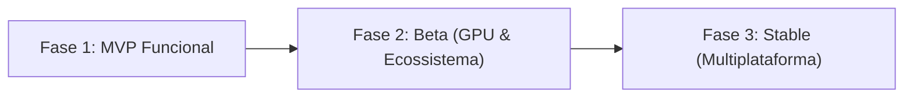

# Roadmap de Desenvolvimento — NServo

Este documento detalha o plano de evolução do navegador **NServo**, desde o MVP (Minimum Viable Product) funcional até o estágio Beta e a versão Stable de produção.

---

## Fase 1: MVP Funcional (Estado Atual)

O MVP estabelece a arquitetura sólida, modular e desacoplada em Rust, com todos os subsistemas essenciais operacionais:

- [x] Arquitetura modular respeitando estritamente o limite de 200 linhas por arquivo.
- [x] Trait `BrowserEngine` abstrata com implementações `ServoEngine` e `MockEngine`.
- [x] Máquina de estados para modos: **Normal**, **Insert**, **Passthrough** e **Command**.
- [x] Keybindings padrão estilo Vim/qutebrowser (`j`, `k`, `h`, `l`, `o`, `O`, `d`, `i`, `ESC`, `:`).
- [x] Barra de comandos estilo Neovim com comandos obrigatórios:
  - `:open`, `:Open`, `:tabnew`, `:tabnext`, `:tabprev`, `:tabclose`, `:tabs`, `:wq`, `:q`, `:plugin`, `:bookmark`, `:clean`.
- [x] Sistema de Autocomplete inteligente ranqueado por histórico, favoritos, frequência e recência.
- [x] Persistência em SQLite para **Histórico** (`history.db`) e **Favoritos** (`bookmarks.db`).
- [x] Bloqueador de anúncios compatível com sintaxe ABP / EasyList (`filters/ads.txt`), com regras de bloqueio de rede, exceções (`@@`) e filtros cosméticos (`##`).
- [x] Suporte a UserScripts no formato **Greasemonkey** com parser de bloco `// ==UserScript==`, regras de `@match` e injeção assíncrona.
- [x] Persistência completa de sessão com `:wq` e restauração automática ao inicializar (`session.json`).
- [x] Sistema de segurança de plugins com prompt interativo `[y]/[n]` e persistência de hashes em `trusted_plugins.json`.
- [x] Plugins padrão embutidos:
  - `pass`: integração com gerenciador Unix pass e preenchimento de formulários.
  - `readability`: modo leitura com remoção de distrações e tipografia solarized/sepia.
- [x] Runtime Lua (Lua 5.4 / mlua) com APIs globais `nservo.*`, `set()`, `bind()`, `command()` e `open()`.
- [x] Testes de integração automatizados e verificação estrita de limites de linhas de código.

---

## Fase 2: Beta (Aceleração por GPU & Ecossistema)

A fase Beta visa aprofundar o pipeline gráfico e a interoperabilidade:

- [ ] **Integração Servo / WebRender / wgpu Nativa Completa**:
  - Composição gráfica acelerada diretamente em superfícies wgpu/Wayland/X11/Metal/DirectX.
  - Renderização offscreen com apresentação por hardware buffers.
  - Pipeline de scrolling suave a 120Hz com interpolação de física.
- [ ] **Mecanismo de Dicas de Navegação (Link Hints)**:
  - Pressionar `f` para exibir letras sobre links clicáveis na página (estilo Vimium/qutebrowser/Nyxt).
- [ ] **Download Manager**:
  - Gerenciador de downloads não intrusivo com fila assíncrona Tokio e notificações no status bar.
- [ ] **Greasemonkey GM_* APIs Avançadas**:
  - Implementação de `GM_xmlhttpRequest`, `GM_setValue`, `GM_getValue`, `GM_addStyle`.
- [ ] **Atualização Automática de Listas Adblock**:
  - Sincronização periódica de EasyList e EasyPrivacy em background com suporte a ETag.
- [ ] **Modo Janela Flutuante / Inspeção**:
  - Mini inspetor de elementos e console interativo com atalho `:inspect`.

---

## Fase 3: Stable (Produção Multiplataforma & Hardening)

A versão Stable garante confiabilidade comercial e paridade completa entre sistemas operacionais:

- [ ] **Linux**:
  - Empacotamento Flatpak, Snap, AppImage, Arch PKGBUILD e Debian `.deb`.
  - Suporte de primeira classe para Wayland nativo sem dependência de XWayland.
- [ ] **macOS**:
  - Bundle `.app` assinado e notarizado para Apple Silicon (M1/M2/M3/M4) e Intel x86_64.
  - Integração com comandos nativos do macOS (`Cmd` vs `Ctrl`).
- [ ] **Windows**:
  - Instalador MSI / WiX Toolset e pacote para WinGet / Chocolatey.
  - Aceleração via DirectX 12 sobre wgpu.
- [ ] **Android**:
  - APK nativo com JNI bridge reutilizando o core compilado em `aarch64-linux-android`.
  - Suporte completo a teclados físicos USB/Bluetooth, atalhos de hardware e touch gestures.
- [ ] **Auditoria de Segurança & Sandboxing de Processos**:
  - Isolamento de abas em processos de renderização não privilegiados (seccomp no Linux, AppContainer no Windows).
  - Sandboxing rígido para execução de plugins Lua de terceiros.
