# nservo Architecture

`nservo` is a Vim/Neovim-inspired GTK4 web browser written in Rust, heavily inspired by [qutebrowser](https://qutebrowser.org/), and powered by [`servo-gtk`](https://github.com/nacho/servo-gtk).

## Design Principles

- **Clean Separation of Concerns:** Pure browser state and input logic (`src/core`) are completely decoupled from GTK4 widgets (`src/ui`) and Servo engine integration (`src/engine`), making the core logic deterministically testable without a display server. Layer boundaries (`src/core` free of GTK/Servo/`ui`/`engine`, and `src/engine` free of `ui`) are enforced automatically by `tests/architecture_tests.rs`.
- **Strict Modularity (`<= 300` lines per file):** Every Rust source and test file is kept small and focused on a single responsibility, enforced automatically by `tests/line_count_test.rs`.
- **Predictable Modal Input:** Key handling uses GTK4's Capture propagation phase so Vim shortcuts never leak into the web page during Normal or Hint mode, while Insert, Command, and focused Inspector widgets receive input cleanly.

## High-Level Diagram

```mermaid
flowchart TD
    Main["src/main.rs\n(servo-gtk runner handoff, epoxy & GPU init, GTK App)"] --> Window["ui::window::BrowserWindow\n+ ui::window_actions"]

    Window --> TabBar["ui::tab_bar::TabBar"]
    Window --> TabView["ui::tab_view::TabView"]
    Window --> Inspector["ui::inspector_panel::InspectorPanel\n+ ui::inspector_views"]
    Window --> StatusBar["ui::status_bar::StatusBar"]
    Window --> CommandBar["ui::command_bar::CommandBar"]
    Window --> KeyHandler["ui::key_handler::KeyHandler\n+ ui::key_chords + ui::im_bridge"]
    Window --> HintCtrl["ui::hint_controller::HintController"]
    Window --> SearchCtrl["ui::search_controller::SearchController"]
    Window --> BookmarkCtrl["ui::bookmark_controller::BookmarkController"]
    Window --> HistoryCtrl["ui::history_controller::HistoryController"]
    Window --> SessionCtrl["ui::session_controller::SessionController"]

    KeyHandler --> KeyMapper["core::keymap::KeyMapper\n(400ms sequence window)"]
    CommandBar --> CmdParser["core::command::parse_command"]

    KeyMapper --> Action["core::action::BrowserAction"]
    CmdParser --> Action
    Action --> Window

    TabView --> TabModel["core::tab_model::TabModel"]
    TabView --> PageOverlay["ui::page_overlay::PageOverlay\n(overlay scrollbars + wheel)"]
    TabView --> TabSignals["ui::tab_signals"]
    PageOverlay --> WebTab["engine::web_tab::WebTab\n+ core::load_state::LoadCoordinator"]
    WebTab --> WebView["servo_gtk::WebView\n(one per tab in gtk::Stack)"]

    SessionCtrl --> SessionStore["core::session::SessionStore"]
    BookmarkCtrl --> BookmarkStore["core::bookmarks::BookmarkStore"]
    HistoryCtrl --> HistoryStore["core::history::HistoryStore"]
    SessionStore --> SqliteDb["core::storage\n($XDG_CONFIG_HOME/nservo/nservo.db)"]
    BookmarkStore --> SqliteDb
    HistoryStore --> SqliteDb
    Window --> ConsoleStore["core::inspector::ConsoleStore"]
    Window --> Scroll["engine::scroll"]
    Scroll --> WebView
    Window --> StartPage["engine::start_page"]
```

## Module Layout

### Entry Point, Crate Root & Build Config
- **`Cargo.toml`** — Configures Rust edition `2024`, `BSD-3-Clause` license metadata, `gtk4` (`0.11`, `v4_12`), `glib`/`gio` (`0.22`), `servo-gtk` (`https://github.com/nacho/servo-gtk`), `servo` (enabling `media-gstreamer` via Cargo feature unification for native `<video>`/`<audio>`/MSE/WebAudio playback), `rusqlite` (`0.38`, `bundled`, for unified SQLite persistence), `epoxy`, `libloading`, `log`, `serde`, and `serde_json`, along with the `[patch.crates-io]` entry for `epoxy` and `[profile.dev.package.*]` optimization overrides (`stylo`, `servo-layout`, `webrender`, `servo-paint`).
- **`.cargo/config.toml`** — Sets `SERVO_STYLE_THREAD_STACK_SIZE_KB = "4096"` so Servo's Stylo worker threads do not overflow their default 512 KiB stack in dev builds.
- **`src/main.rs`** — Invokes `servo_gtk::run_as_runner_if_requested()` as its first statement (required because `servo-gtk` re-executes the application binary for Servo subprocesses), configures `GlibLogger`, initializes the `epoxy` OpenGL loader, selects the GPU-first/CPU-fallback render environment, installs the CSS theme, and opens `BrowserWindow` with an optional CLI URL argument.
- **`src/lib.rs`** — Exports `core`, `engine`, and `ui` modules for both the binary target and integration tests.

### `src/core/` — Pure Domain Logic
- **`src/core/mode.rs`** — Defines `Mode` (`Normal`, `Insert`, `Command`, `Search`, `Hint`) along with statusline labels and CSS classes.
- **`src/core/action.rs`** — Defines `BrowserAction`, the uniform command/action vocabulary emitted by keybindings, Ctrl chords, IME commits, and Ex-style commands, plus `ZOOM_STEP` and `step_zoom`.
- **`src/core/bookmarks.rs`** — Stores, deduplicates, lists, and removes bookmarks (`Bookmark`, `BookmarkStore`) in SQLite (`bookmarks` table in `$XDG_CONFIG_HOME/nservo/nservo.db`).
- **`src/core/hints.rs`** — Prefix-free alphabetic hint label generator (`a`..`z`, `aa`..`zz`) and `HintEvent` JSON message parser.
- **`src/core/history.rs`** — Records, coalesces, title-updates, searches, and clears browsing history (`HistoryEntry`, `HistoryStore`, `HistorySync`) in SQLite (`history` table in `$XDG_CONFIG_HOME/nservo/nservo.db`).
- **`src/core/keymap.rs`** — Implements `KeyMapper`, a deterministic key-sequence state machine with `KEY_SEQUENCE_TIMEOUT = 400ms`:
  - **Normal mode:** `j`/`k` (scroll down/up), `h`/`l` (scroll left/right), `G` (scroll bottom), `gg` (scroll top), `gt`/`gT` (next/previous tab), `go` (edit current URL in Command mode with `:open <URL>`), `gh` (open browsing history `about:history`), `wi` (toggle built-in Web Inspector), `f` (Hint mode), `/` (Search mode), `n`/`N` (next/previous search result), `Esc` (clear active search highlights), `b`/`B` (add current page to bookmarks / open bookmarks), `d` (close current tab), `u` (reopen last closed tab), `o`/`O` (Command mode pre-filled with `:open ` / `:Open `), `H`/`L` (history back/forward), `r`/`F5` (reload), `i` (Insert mode), `:` (Command mode).
  - **Hint mode:** Captures letter keys to filter/click hinted elements (`BackSpace` edits prefix, `Esc` cancels back to Normal mode).
  - **Insert mode:** Passes keys through to the page; `Esc` (or page navigation on the active tab) returns to Normal mode.
  - **Command / Search mode:** Passes keys through to the prompt entry; `Esc` returns to Normal mode.
- **`src/core/command.rs`** — Parses Ex-style commands (`:open <URL|query>`, `:Open <URL|query>`, `:tabnext`, `:tabprev`, `:tabclose`, `:reload`, `:back`, `:forward`, `:zoom <factor|reset>`, `:inspect`, `:noh`/`:nohlsearch`, `:w [name]`, `:wq [name]`, `:session <name>`, `:bookmark`, `:bookmarks`, `:bmdel [index|URL]`, `:history [query]`, `:history-clear`, `:help`, `:q` and their short aliases), normalizes bare hostnames/IPs into full URLs, and falls back to Google Search (`https://www.google.com/search?q=...`) for non-URL queries.
- **`src/core/inspector.rs`** — Defines per-tab `ConsoleStore`, `ConsoleLevel`, `ConsoleEntry`, `DomNodeSummary`, `ElementDetails`, and JSON message parsing (`InspectorEvent`) for the built-in Web Inspector.
- **`src/core/load_state.rs`** — Pure `LoadCoordinator` and `LoadTarget` state machine that queues initial loads until `servo-gtk`'s `about:blank` browsing-context handshake finishes, retries dropped fallback loads, and filters transient `about:blank` / `data:text/html` URI notifications.
- **`src/core/scroll_state.rs`** — Defines `ScrollMetrics` and `parse_scroll_metrics` to validate and parse viewport/document scroll geometry sent from the page bridge.
- **`src/core/search.rs`** — Defines `SearchState`, `SearchEvent`, `parse_search_message`, and Neovim-style statusline formatting (`format_search_status`) for `/`, `n`, `N`, and `:noh`.
- **`src/core/session.rs`** — Persists and loads named sessions (`Session`, `SavedTab`, `SessionStore`) atomically in SQLite (`sessions` and `session_tabs` tables in `$XDG_CONFIG_HOME/nservo/nservo.db`), validating session names and supporting automatic `"default"` session restore on startup.
- **`src/core/storage.rs`** — Resolves `$XDG_CONFIG_HOME/nservo/nservo.db` (falling back to `$HOME/.config/nservo/nservo.db`) via pure `std::env` resolution and initializes the unified SQLite schema (`sessions`, `session_tabs`, `bookmarks`, `history`) in WAL mode with foreign keys enabled.
- **`src/core/tab_model.rs`** — Maintains ordered `TabInfo` metadata (`id`, `url`, `title`, `is_loading`), active tab index, wrap-around switching (`next_tab` / `prev_tab`), safe removal on tab close, and a LIFO `ClosedTab` history stack for reopening closed tabs (`u`).
- **`src/core/text_input.rs`** — UTF-16 code-unit encoding/decoding (`encode_utf16_units`, `decode_utf16_units`), word/line motion enums (`WordDirection`, `LineEdge`), and fallback `DeadKeyComposer` for accented Latin/Portuguese characters and supplementary Unicode surrogate pairs.

### `src/engine/` — Servo Engine Integration
- **`src/engine/bookmarks_page.rs`** — Renders the built-in dark Tokyo Night `about:bookmarks` HTML page with HTML-escaped links for keyboard hint navigation.
- **`src/engine/clipboard.rs`** — Copies (`Ctrl+C`) and cuts (`Ctrl+X`) selected page/input text to GTK4's system clipboard via `UserContentManager` (`nservoClipboard`), and pastes clipboard text into focused inputs as UTF-16 on `Ctrl+V`.
- **`src/engine/epoxy.rs`** — Dynamically loads `libepoxy.so.0` and binds GL symbols for `servo-gtk`.
- **`src/engine/gpu.rs`** — Detects GPU DRM render nodes (`/dev/dri/renderD*`), configures GTK4 GPU-first rendering (Vulkan → GL) with automatic CPU (Cairo) fallback when hardware acceleration is unavailable, and observes the active `GskRenderer` for statusline display.
- **`src/engine/scroll.rs`** — Provides brisk time-based `requestAnimationFrame` smooth scrolling (`j`/`k`/`h`/`l`/`gg`/`G` and discrete mouse wheel) using `behavior: 'instant'` per frame to avoid CSS double-smoothing, hides redundant default scrollbars via `UserStyleSheet`, and reports viewport scroll geometry over `UserContentManager` (`nservoScroll`).
- **`src/engine/search_js.rs`** — Injected `UserScript` and search/step/clear scripts that perform smartcase DOM text highlighting (`<mark data-nservo-search>`), smoothly scroll matches into view, support wrapping `n`/`N` navigation, cleanly unwrap highlights on clear, and report match counts over `UserContentManager` (`nservoSearch`).
- **`src/engine/start_page.rs`** — Provides the built-in dark Neovim-styled start and `:help` HTML page loaded via `WebView::load_html`.
- **`src/engine/hints_js.rs`** — Injected JavaScript scripts that highlight visible links/buttons/inputs with letter badges, filter and click/focus matched elements, and post activation/input-mode events back over `UserContentManager` (`nservoHints`).
- **`src/engine/history_page.rs`** — Renders the built-in dark Tokyo Night `about:history` HTML page (with optional search filtering and HTML escaping) for keyboard hint navigation.
- **`src/engine/inspector_js.rs`** — Injected `UserScript` and evaluation/DOM-inspection scripts that capture `console.*` + uncaught JS errors, run REPL expressions, snapshot the DOM tree, and highlight inspected elements over `UserContentManager` (`nservoInspector`).
- **`src/engine/text_input_js.rs`** — Injects UTF-16 code units via `String.fromCharCode(...)` into the focused `<input>`, `<textarea>`, or `[contenteditable]` element (with native value setters and `InputEvent` dispatch) and implements word-wise (`Ctrl+Arrow` / `Ctrl+Shift+Arrow`) and line-boundary (`Ctrl+A` / `Ctrl+E`) cursor movement.
- **`src/engine/web_tab.rs`** — Wraps `servo_gtk::WebView` with a `UserContentManager` (registering `nservoHints`, `nservoClipboard`, `nservoInspector`, `nservoScroll`, and `nservoSearch`, plus scroll/inspector/search user scripts and CSS), `core::LoadCoordinator` readiness queuing with a 5-second fallback timer, `WeakWebTab` handles to avoid GObject cycles on tab close, and `nudge_repaint()`.

### `src/ui/` — GTK4 Vim-Style Interface
- **`src/ui/style.rs`** — Installs the dark Tokyo Night / Neovim CSS stylesheet via `gtk::CssProvider`.
- **`src/ui/tab_bar.rs`** — Top tabline displaying numbered tabs, loading indicators, and active tab styling.
- **`src/ui/page_overlay.rs`** — Wraps each `WebTab`'s `WebView` in a `gtk::Overlay` with auto-hiding, hover-expanding GTK4 overlay scrollbars and smooth discrete mouse-wheel scrolling (letting smooth touchpad gestures pass directly to Servo).
- **`src/ui/tab_signals.rs`** — Connects `WebView` (`notify::uri`, `notify::title`, `load-changed`, `notify::zoom-level`, `create-web-view`) and `UserContentManager` script message signals (`nservoHints`, `nservoInspector`, `nservoScroll`) to `TabModel`, `WeakPageOverlay`, and `TabViewCallbacks`.
- **`src/ui/tab_view.rs`** — Manages a `gtk::Stack` of live `PageOverlay`-wrapped `WebTab` instances indexed by tab ID, handling tab creation, switching, closing, reopening, and session restoration.
- **`src/ui/status_bar.rs`** — Bottom statusline showing the active mode badge (`NORMAL`, `INSERT`, `COMMAND`, `HINT`), page title/URL (or command notices/errors), pending key prefix (`g`/`w` or typed hint letters), tab counter (`1/N`), zoom percentage (`ZOOM 100%`), and active render backend (`GPU:Vulkan`, `GPU:GL`, `CPU:Cairo`).
- **`src/ui/command_bar.rs`** — Bottom prompt `gtk::Entry` bar displaying `:` in Command mode and `/` in Search mode, hidden in Normal, Insert, and Hint modes.
- **`src/ui/im_bridge.rs`** — Bridges `gtk::IMMulticontext` and `core::DeadKeyComposer` in Insert mode so dead keys, Portuguese accents, Compose sequences, and system IMEs commit UTF-16 text into web page inputs.
- **`src/ui/inspector_panel.rs`** — Built-in GTK4 Web Inspector drawer (JS Console/REPL + DOM tree & computed-style inspector) toggled with `wi` or `:inspect`.
- **`src/ui/inspector_views.rs`** — Constructs the Console and DOM sub-views inside `InspectorPanel` and wires `Up`/`Down` REPL history navigation.
- **`src/ui/key_chords.rs`** — Matches global zoom chords (`Ctrl++`/`Ctrl+=`, `Ctrl+-`, `Ctrl+0`), editing/clipboard chords (`Ctrl+C`/`X`/`V`/`A`/`E`), and Insert-mode word motion (`Ctrl[+Shift]+Arrow`), and translates GDK keys/modifiers into `core::KeyInput`.
- **`src/ui/key_handler.rs`** — Attaches a Capture-phase `gtk::EventControllerKey` to `ApplicationWindow`:
  - Ignores modifier-only key presses (e.g. `Shift_L`) so pressing `g` followed by `Shift+T` cleanly matches `gT`.
  - Handles global zoom chords, focused Inspector typing (`Esc` returns to Normal mode), empty Command-bar `BackSpace` exit, and editing/clipboard/word-motion chords.
  - Lets remaining system/WM chords (`Ctrl`, `Alt`, `Super`, `Meta`) propagate.
  - Routes Insert-mode text through `ImBridge` and Normal/Hint/Command keys through `KeyMapper`, scheduling/cancelling a `400ms` `glib::timeout_add_local_once` timer for multi-key prefixes.
- **`src/ui/bookmark_controller.rs`** — Coordinates adding (`b` / `:bookmark`), viewing (`B` / `:bookmarks`), and removing (`:bmdel`) bookmarks between `BookmarkStore`, `TabView`, and `StatusBar`.
- **`src/ui/hint_controller.rs`** — Tracks the typed hint prefix and coordinates hint activation, filtering, backspace, and cleanup on the active tab.
- **`src/ui/history_controller.rs`** — Persists navigation/title updates into `HistoryStore` and renders/clears `about:history` on demand.
- **`src/ui/search_controller.rs`** — Tracks the active search register (`SearchState`) and coordinates `/`, `n`, `N`, highlight clearing, and `StatusBar` match feedback across tabs.
- **`src/ui/session_controller.rs`** — Coordinates startup session restore (CLI URL → saved `"default"` session → built-in start/help page) and `:w` / `:wq` / `:session` operations between `SessionStore`, `TabView`, and `StatusBar`.
- **`src/ui/window.rs`** — `BrowserWindow` wires widgets, layout (`gtk::Paned` for web content + inspector), mode transitions, command submission, and UI chrome synchronization.
- **`src/ui/window_actions.rs`** — Implements `BrowserWindow::handle_action` plus hint, inspector, and navigation event handlers.

## Input & Command Flow

1. **Key press arrives at `ApplicationWindow`** during GTK's Capture phase (`KeyHandler`).
2. `KeyHandler` checks modifier-only keys, global zoom chords (`Ctrl++`/`-`/`0`), focused Inspector input, empty-entry `BackSpace` in Command mode, and editing/clipboard/word-motion chords (`key_chords.rs`). Remaining non-text WM chords propagate untouched.
3. In **Insert mode**, `Esc` returns to Normal mode and all other keys pass through `ImBridge` (either emitting `BrowserAction::InsertText`, consuming dead-key/IME composition, or passing through to `servo-gtk`).
4. In **Normal, Hint, and Command modes**, `KeyHandler` translates the GDK key into `KeyInput` and calls `KeyMapper::handle_key(mode, input, Instant::now())`:
   - `Pending(prefix)` — Starts a `400ms` GLib timeout, displays the prefix in `StatusBar`, and stops event propagation. If the timer expires before a second key arrives, the pending buffer and status indicator clear.
   - `Action(action)` — Cancels any pending timer, dispatches `action` to `BrowserWindow::handle_action`, and stops event propagation.
   - `Consumed` — Cancels any pending timer and stops propagation so Normal/Hint-mode keys do not leak into the `WebView`.
   - `PassThrough` — Allows the event to reach the focused `CommandBar` entry.
5. **Command submission** (`Enter` in Command mode) switches back to Normal mode, calls `parse_command`, and either executes the resulting `BrowserAction` or displays the error message in `StatusBar`.

## Test Suite

- **`tests/architecture_tests.rs`** — Enforces layer isolation: `src/core/` cannot depend on GTK/GLib/Servo/`src/ui`/`src/engine`, and `src/engine/` cannot depend on `src/ui`.
- **`tests/line_count_test.rs`** — Asserts that every `.rs` file in `src/` and `tests/` contains at most 300 lines.
- **`tests/integration/main.rs`** — Single integration test harness linking `nservo` once for all modules below:
  - **`tests/integration/bookmarks_tests.rs`** — Verifies `$XDG_CONFIG_HOME/nservo` path resolution, bookmark deduplication/removal/validation, `b`/`B` and `:bookmark*` bindings, and HTML escaping on `about:bookmarks`.
  - **`tests/integration/command_tests.rs`** — Verifies `:open` vs `:Open`, aliases, zoom validation, session commands, error cases, URL normalization, and Google Search fallback.
  - **`tests/integration/gpu_tests.rs`** — Verifies `GskRenderer` classification (Vulkan/GL/Cairo) and DRM render node detection.
  - **`tests/integration/hints_tests.rs`** — Verifies prefix-free hint label generation, `HintEvent` JSON parsing, and Hint-mode key handling.
  - **`tests/integration/history_tests.rs`** — Verifies SQLite browsing history recording, coalescing, title updates, search/escaping, clearing, shared-DB persistence with sessions/bookmarks, `gh`/`:history*` bindings, and `about:history` HTML rendering.
  - **`tests/integration/inspector_tests.rs`** — Verifies `ConsoleStore` tab isolation, DOM/element formatting, inspector JSON message parsing, and injected JS safety.
  - **`tests/integration/keymap_tests.rs`** — Verifies mode transitions, `j`/`k`/`G`/`gg`, `gt`/`gT`, `go`, and exact `400ms` timeout boundary behavior (`399ms` succeeds, `400ms` expires).
  - **`tests/integration/load_state_tests.rs`** — Verifies `LoadCoordinator` startup handshake queuing, fallback retry on `about:blank`, and built-in HTML URI filtering.
  - **`tests/integration/scroll_tests.rs`** — Verifies `ScrollMetrics` parsing/validation and generated smooth-scroll scripts/CSS.
  - **`tests/integration/search_tests.rs`** — Verifies `/`, `n`, `N`, `Esc`, and `:noh` mappings, `SearchState`, search event parsing/status formatting, and safe JS query encoding.
  - **`tests/integration/session_tests.rs`** — Verifies saving/loading default and named sessions, session-name validation, and XDG directory resolution.
  - **`tests/integration/tab_model_tests.rs`** — Verifies tab creation, wrap-around switching, tab closure, LIFO closed-tab reopening (`u`), and display titles.
  - **`tests/integration/text_input_tests.rs`** — Verifies UTF-16 encoding/decoding, `DeadKeyComposer` diacritics, word/line motion scripts, and clipboard payload parsing.
