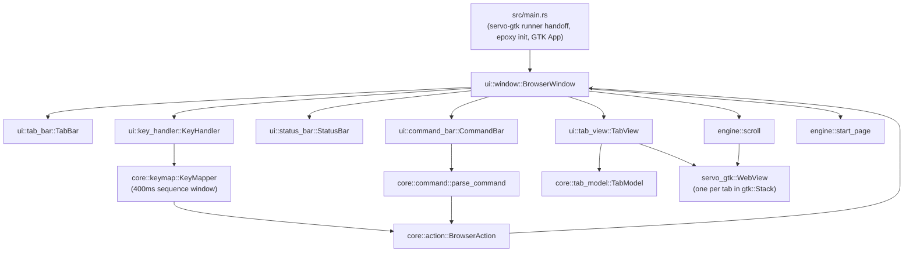

# nservo Architecture

`nservo` is a Neovim-inspired GTK4 web browser written in Rust and powered by [`servo-gtk`](https://github.com/nacho/servo-gtk).

## Design Principles

- **Clean Separation of Concerns:** Pure browser state and input logic (`src/core`) are completely decoupled from GTK4 widgets (`src/ui`) and Servo engine integration (`src/engine`), making the core logic deterministically testable without a display server.
- **Strict Modularity (`<= 300` lines per file):** Every Rust source and test file is kept small and focused on a single responsibility, enforced automatically by `tests/line_count_test.rs`.
- **Predictable Modal Input:** Key handling uses GTK4's Capture propagation phase so Neovim shortcuts never leak into the web page during Normal mode, while Insert and Command modes delegate naturally to the focused widget.

## High-Level Diagram

## Module Layout

### Entry Point & Crate Root
- **`Cargo.toml`** — Declares `gtk4` (`0.11`), `glib`/`gio` (`0.22`), `servo-gtk` (`https://github.com/nacho/servo-gtk`), `servo` (enabling `media-gstreamer` via Cargo feature unification for native `<video>`/`<audio>`/MSE/WebAudio playback), `epoxy`, and `libloading`, along with the `[patch.crates-io]` entry for `epoxy` required by `servo-gtk`.
- **`src/main.rs`** — Invokes `servo_gtk::run_as_runner_if_requested()` as its first statement (required because `servo-gtk` re-executes the application binary for Servo subprocesses), initializes the `epoxy` OpenGL loader, installs the CSS theme, and opens `BrowserWindow`.
- **`src/lib.rs`** — Exports `core`, `engine`, and `ui` modules for both the binary target and integration tests.

### `src/core/` — Pure Domain Logic
- **`src/core/mode.rs`** — Defines `Mode` (`Normal`, `Insert`, `Command`, `Hint`) along with statusline labels and CSS classes.
- **`src/core/action.rs`** — Defines `BrowserAction`, the uniform command/action vocabulary emitted by both keybindings and Ex-style commands.
- **`src/core/hints.rs`** — Prefix-free alphabetic hint label generator (`a`..`z`, `aa`..`zz`) and `HintEvent` JSON message parser.
- **`src/core/keymap.rs`** — Implements `KeyMapper`, a deterministic key-sequence state machine with `KEY_SEQUENCE_TIMEOUT = 400ms`:
  - **Normal mode:** `j`/`k` (scroll down/up), `h`/`l` (scroll left/right), `G` (scroll bottom), `gg` (scroll top), `gt`/`gT` (next/previous tab), `go` (edit current URL in Command mode with `:open <URL>`), `wi` (toggle built-in Web Inspector), `f` (Hint mode), `d` (close current tab), `u` (reopen last closed tab), `o`/`O` (Command mode pre-filled with `:open ` / `:Open `), `H`/`L` (history back/forward), `r`/`F5` (reload), `i` (Insert mode), `:` (Command mode).
  - **Hint mode:** Captures letter keys to filter/click hinted elements (`BackSpace` edits prefix, `Esc` cancels back to Normal mode).
  - **Insert mode:** Passes keys through to the page; `Esc` (or page navigation on the active tab) returns to Normal mode.
  - **Command mode:** Passes keys through to the command entry; `Esc` returns to Normal mode.
- **`src/core/command.rs`** — Parses Ex-style commands (`:open <URL|query>`, `:Open <URL|query>`, `:tabnext`, `:tabprev`, `:tabclose`, `:reload`, `:back`, `:forward`, `:zoom <factor|reset>`, `:w [name]`, `:wq [name]`, `:session <name>`, `:help`, `:q`), normalizes bare hostnames/IPs into full URLs, and falls back to Google Search (`https://www.google.com/search?q=...`) for non-URL queries.
- **`src/core/inspector.rs`** — Defines per-tab `ConsoleStore`, `ConsoleEntry`, `DomNodeSummary`, `ElementDetails`, and JSON message parsing (`InspectorEvent`) for the built-in Web Inspector.
- **`src/core/session.rs`** — Serializes and loads named JSON sessions (`Session`, `SavedTab`, `SessionStore`) under `$XDG_DATA_HOME/nservo/sessions/`, validating session names and supporting automatic `"default"` session restore on startup.
- **`src/core/tab_model.rs`** — Maintains ordered `TabInfo` metadata (`id`, `url`, `title`, `is_loading`), active tab index, wrap-around switching (`next_tab` / `prev_tab`), and safe removal on tab close.
- **`src/core/text_input.rs`** — UTF-16 code-unit encoding/decoding (`encode_utf16_units`, `decode_utf16_units`) and fallback `DeadKeyComposer` for accented Latin/Portuguese characters and supplementary Unicode surrogate pairs.

### `src/engine/` — Servo Engine Integration
- **`src/engine/clipboard.rs`** — Copies (`Ctrl+C`) and cuts (`Ctrl+X`) selected page/input text to GTK4's system clipboard via `UserContentManager` (`nservoClipboard`), and pastes clipboard text into focused inputs as UTF-16 on `Ctrl+V`.
- **`src/engine/epoxy.rs`** — Dynamically loads `libepoxy.so.0` and binds GL symbols for `servo-gtk`.
- **`src/engine/gpu.rs`** — Detects GPU DRM render nodes (`/dev/dri/renderD*`), configures GTK4 GPU-first rendering (Vulkan → GL) with automatic CPU (Cairo) fallback when hardware acceleration is unavailable, and observes the active `GskRenderer` for statusline display.
- **`src/engine/scroll.rs`** — Provides `requestAnimationFrame`-based smooth scrolling (`j`/`k`/`h`/`l`/`gg`/`G` and discrete mouse wheel), hides redundant default scrollbars via `UserStyleSheet`, and reports viewport scroll geometry over `UserContentManager` (`nservoScroll`).
- **`src/engine/start_page.rs`** — Provides the built-in dark Neovim-styled start and `:help` HTML page loaded via `WebView::load_html`.
- **`src/engine/hints_js.rs`** — Injected JavaScript scripts that highlight visible links/buttons/inputs with letter badges, filter and click/focus matched elements, and post activation/input-mode events back over `UserContentManager`.
- **`src/engine/inspector_js.rs`** — Injected `UserScript` and evaluation/DOM-inspection scripts that capture `console.*` + uncaught JS errors, run REPL expressions, snapshot the DOM tree, and highlight inspected elements over `UserContentManager` (`nservoInspector`).
- **`src/engine/text_input_js.rs`** — Injects UTF-16 code units via `String.fromCharCode(...)` into the focused `<input>`, `<textarea>`, or `[contenteditable]` element (with native value setters and `InputEvent` dispatch) and implements word-wise (`Ctrl+Arrow` / `Ctrl+Shift+Arrow`) and line-boundary (`Ctrl+A` / `Ctrl+E`) cursor movement.
- **`src/engine/web_tab.rs`** — Wraps `servo_gtk::WebView` with a `UserContentManager` (`nservoHints` handler) and readiness-aware load queuing so initial loads wait for Servo's asynchronous `about:blank` browsing-context handshake (`LoadEvent::Finished`) before dispatching.

### `src/ui/` — GTK4 Neovim-Style Interface
- **`src/ui/style.rs`** — Installs the dark Neovim CSS stylesheet via `gtk::CssProvider`.
- **`src/ui/tab_bar.rs`** — Top tabline displaying numbered tabs, loading indicators, and active tab styling.
- **`src/ui/tab_view.rs`** — Manages a `gtk::Stack` of live `PageOverlay`-wrapped `WebTab` instances (with auto-hiding, hover-expanding GTK4 overlay scrollbars in `src/ui/page_overlay.rs`) indexed by tab ID, wiring navigation, zoom, popups, hints, inspector, and scroll bridges via `src/ui/tab_signals.rs`.
- **`src/ui/status_bar.rs`** — Bottom statusline showing the active mode badge (`NORMAL`, `INSERT`, `COMMAND`, `HINT`), page title/URL, pending key prefix (`g`/`w`), tab counter (`1/N`), zoom percentage (`ZOOM 100%`), and active render backend.
- **`src/ui/command_bar.rs`** — Bottom `:`-prefixed `gtk::Entry` bar shown only while in Command mode and hidden in Normal and Insert modes.
- **`src/ui/im_bridge.rs`** — Bridges `gtk::IMMulticontext` (and fallback `DeadKeyComposer`) in Insert mode so dead keys, Portuguese accents, Compose sequences, and system IMEs commit UTF-16 text into web page inputs.
- **`src/ui/inspector_panel.rs`** — Built-in GTK4 Web Inspector drawer (JS Console/REPL with history + DOM tree & computed-style inspector) toggled with `wi` or `:inspect`.
- **`src/ui/key_handler.rs`** — Attaches a Capture-phase `gtk::EventControllerKey` to `ApplicationWindow`:
  - Ignores modifier-only key presses (e.g. `Shift_L`) so pressing `g` followed by `Shift+T` cleanly matches `gT`.
  - Lets system/WM chords (`Ctrl`, `Alt`, `Super`, `Meta`) propagate.
  - Exits Command mode when `BackSpace` is pressed on an empty command entry.
  - Schedules/cancels a `400ms` `glib::timeout_add_local_once` timer whenever a multi-key prefix is buffered.
- **`src/ui/hint_controller.rs`** — Tracks the typed hint prefix and coordinates hint activation, filtering, backspace, and cleanup on the active tab.
- **`src/ui/session_controller.rs`** — Coordinates startup session restore and `:w` / `:wq` / `:session` operations between `SessionStore`, `TabView`, and `StatusBar`.
- **`src/ui/window.rs`** — `BrowserWindow` coordinates all widgets, mode transitions, command submission, action execution, and UI chrome synchronization.

## Input & Command Flow

1. **Key press arrives at `ApplicationWindow`** during GTK's Capture phase (`KeyHandler`).
2. `KeyHandler` translates the GDK key into `KeyInput` and calls `KeyMapper::handle_key(mode, input, Instant::now())`.
3. Depending on `KeyOutcome`:
   - `Pending(prefix)` — Starts a `400ms` GLib timeout, displays the prefix in `StatusBar`, and stops event propagation. If the timer expires before a second key arrives, the pending buffer and status indicator clear.
   - `Action(action)` — Cancels any pending timer, dispatches `action` to `BrowserWindow::handle_action`, and stops event propagation.
   - `Consumed` — Cancels any pending timer and stops propagation so Normal-mode keys do not leak into the `WebView`.
   - `PassThrough` — Allows the event to reach the focused `WebView` (Insert mode) or `CommandBar` entry (Command mode).
4. **Command submission** (`Enter` in Command mode) calls `parse_command`, switches back to Normal mode, and either executes the resulting `BrowserAction` or shows the error in `CommandBar`.

## Test Suite

- **`tests/command_tests.rs`** — Verifies `:open` vs `:Open`, aliases, zoom validation, error cases, and URL normalization.
- **`tests/keymap_tests.rs`** — Verifies mode transitions, `j`/`k`/`G`/`gg`, `gt`/`gT`, and exact `400ms` timeout boundary behavior (`399ms` succeeds, `400ms` expires).
- **`tests/tab_model_tests.rs`** — Verifies tab creation, wrap-around switching, tab closure, and metadata display titles.
- **`tests/line_count_test.rs`** — Asserts that every `.rs` file in `src/` and `tests/` contains at most 300 lines.
